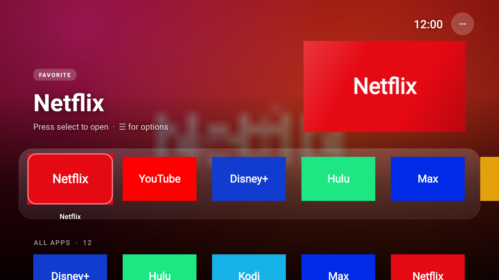
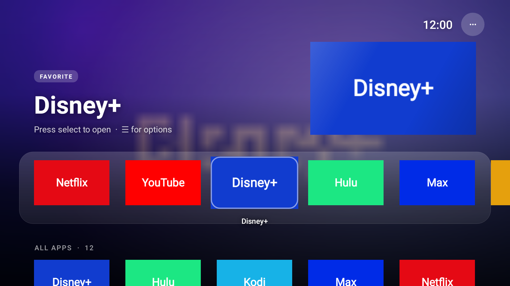
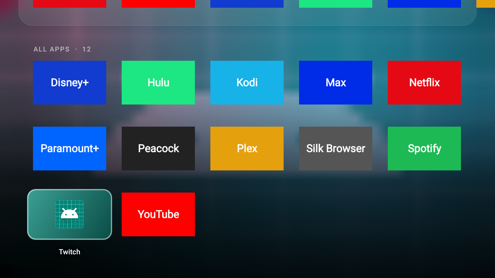

# Sprik Home — ad-free Fire TV launcher + debloat

For **Jessica's Fire TV** (Fire TV Stick 4K Max 2nd gen, Fire OS 8.1.8.5, IP `192.168.1.175`).



**Sprik Home** is a tiny (~30 KB) Apple TV–style home screen with no ads, no tracking and no internet access.

- **Top shelf:** a big preview of whatever app you're on, with its name and how often you use it.
- **Glass dock** of your favorite apps, and every app in a grid below.
- **Tiles lift, tilt and shine** when you move onto them; the name appears underneath.
- **Living colors:** a slow aurora glow behind everything that takes on the colors of the app
  you're on. Or pick Time of day, Aurora, Sunset, Ocean, Neon or Mono (••• → Colors).

| Neon colors | Scrolled into All Apps |
|---|---|
|  |  |

## Automation (••• → Automation)
| Feature | What it does | Default |
|---|---|---|
| Smart dock | Puts your most-used apps first, automatically | On |
| Free up memory | Closes leftover background apps when you come back home, so the next app opens faster | On |
| Night mode | 10 PM–6 AM: warmer, dimmer colors | On |
| Ambient clock | After a few idle minutes on the home screen, shows a big drifting clock over the aurora (any button wakes it) | 5 min |
| Open at start-up | Opens an app of your choice right after the TV turns on (also: ☰ on an app → *Open when TV turns on*) | Off |

## What you need
- A computer (Windows, Mac or Linux) on the same Wi-Fi as the TV.
- **adb**: download "SDK Platform-Tools" from
  https://developer.android.com/tools/releases/platform-tools and unzip it.
  - Windows: copy `adb.exe`, `AdbWinApi.dll`, `AdbWinUsbApi.dll` into the `firetv` folder.
  - Mac: `brew install android-platform-tools`.
- On the TV: **Settings → My Fire TV → Developer options → ADB debugging: ON** (already done).

## One-time setup
1. Download this repo (green **Code** button → Download ZIP) and unzip it.
2. Run it:
   - **Windows:** double-click `firetv\setup.bat`
   - **Mac/Linux:** `cd firetv && ./setup.sh`
3. The TV asks **"Allow USB debugging?"** → tick *Always allow* → **OK**.

That installs Sprik Home, turns off Amazon ads/tracking/junk, speeds up animations,
and makes the **Home button open Sprik Home**.

## Optional extras
Add words after the command (`setup.bat extra` or `./setup.sh extra noupdates`):

| Word | What it does |
|---|---|
| `extra` | Also turns off Live TV tab, Silk browser, Kids profiles, Amazon push service, Alexa notifications, parental controls |
| `noupdates` | Blocks automatic Fire OS updates (updates can undo this setup) |
| `optimize` | Pre-compiles all apps so they open faster (5–15 min) |
| `scan` | Lists every Amazon package and which are off |
| `home` | Re-enables the Home button redirect (use if it stops after a reboot) |
| `restore` | **Undoes everything** |

## Using Sprik Home
- **☰ (menu button)** on any app: add to / remove from the dock, open at start-up, hide, app info, uninstall.
  (Turn off *Smart dock* if you want to arrange the dock yourself.)
- **•••** (top right): colors, motion effects on/off, automation, show hidden apps, Home button on/off,
  Fire TV settings, and the Amazon home screen if you ever need it.
- **Back** on the home screen just jumps to the top.

## Updating
Already set up? Run `setup.bat` / `./setup.sh` again — it installs the new version over the old one and keeps your settings.

## Do these on the TV too (big speed wins)
- Settings → Preferences → **Featured Content** → turn off *Video autoplay* and *Audio autoplay*.
- Settings → Preferences → **Privacy Settings** → turn off *Device Usage Data*,
  *Collect App Usage Data*, *Interest-based Ads*.
- Settings → Preferences → **Data Monitoring** → off.
- Settings → Applications → **Appstore** → *Automatic updates* off (optional).

## How it works / safety
- Fire OS doesn't let you change the home app, so Sprik Home uses an accessibility helper:
  when Amazon's home screen appears, it opens Sprik Home on top. Voice search results,
  profiles and settings screens are left alone.
- Debloat uses `pm disable-user` (or `pm uninstall --user 0` when Amazon blocks disabling).
  Nothing is deleted from the system, and `restore` brings it all back. A factory reset also does.
- Packages that don't exist on this TV are skipped.

## Rebuilding the app
```
cd launcher && ./gradlew assembleRelease
cp app/build/outputs/apk/release/app-release.apk ../dist/SprikHome.apk
```
Needs JDK 17+ and the Android SDK (platform 34). A build signed with a different key than
the one on the TV won't install over it; uninstall Sprik Home first (you'll lose favorites).
