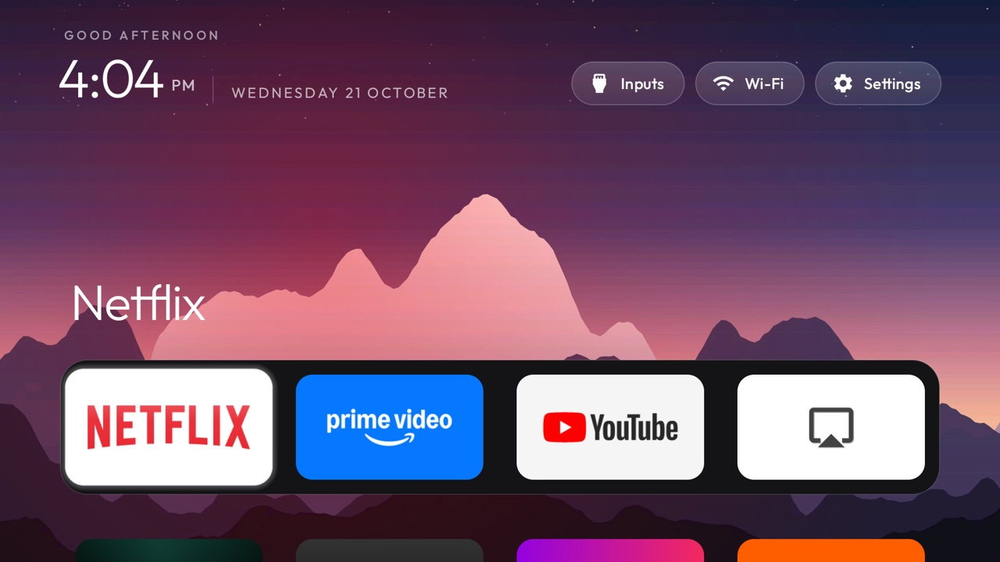

# Fire TV cleanup: CleanYourTV launcher + debloat

For **Jessica's Fire TV** (Fire TV Stick 4K Max 2nd gen, Fire OS 8.1.8.5, IP `192.168.1.175`).



This repo sets up:
- **[CleanYourTV](https://github.com/Gathin23/cleanyourtv)'s Apple TV–style launcher** (MIT), built for
  this Fire TV so the **Home button opens it** instead of Amazon's ad-filled home. No ads, no internet access.
- **Debloat**: CleanYourTV's list tested on this exact Stick, turning off Amazon tracking, ads and junk.
- **Themes** you can switch with one command, with photo wallpapers.
- **Sprik Home**, our own smaller launcher, as an alternative (`sprik`).

## What you need
- A computer (Windows, Mac or Linux) on the same Wi-Fi as the TV.
- **adb**: download "SDK Platform-Tools" from
  https://developer.android.com/tools/releases/platform-tools and unzip it.
  - Windows: copy `adb.exe`, `AdbWinApi.dll`, `AdbWinUsbApi.dll` into the `firetv` folder.
  - Mac: `brew install android-platform-tools`.
- On the TV: **Settings → My Fire TV → Developer options → ADB debugging: ON** (already done).

## One-time setup
1. Download this repo (green **Code** button → Download ZIP) and unzip it.
2. Run it:
   - **Windows:** double-click `firetv\setup.bat`
   - **Mac/Linux:** `cd firetv && ./setup.sh`
3. The TV asks **"Allow USB debugging?"** → tick *Always allow* → **OK**.

That installs CleanYourTV, turns off Amazon ads/tracking/junk and makes the **Home button open it**.

## Themes
`setup.bat theme scenes` (Windows) or `./setup.sh theme scenes` (Mac). `theme-reset` goes back to the default.

| Theme | Look |
|---|---|
| `scenes` | Rotating landscape photos (dusk peaks, aurora, city lights…) |
| `nature-calm` | Calm nature photos |
| `aurora` | Northern-lights wallpaper |
| `cinematic` | Dark movie-theater look |
| `glass` | Frosted glass |
| `storm` | Stormy sky |
| `retro` | Wallpaper that changes with the time of day |
| `red-rain` | Dark red |
| `minimal` | Plain and simple |
| `default` | The built-in look |

More themes: [CleanYourTV themes](https://github.com/Gathin23/cleanyourtv/tree/main/themes).

## Optional extras
Add words after the command (`setup.bat extra` or `./setup.sh extra noupdates`):

| Word | What it does |
|---|---|
| `extra` | Also turns off Alexa extras (alarms, timers, Alexa music), Amazon casting, smart-home views, profile sync and Amazon sign-in for apps. Alexa voice still works |
| `noupdates` | Blocks automatic Fire OS updates (updates can undo this setup) |
| `optimize` | Pre-compiles all apps so they open faster (5–15 min) |
| `scan` | Lists every Amazon package and which are off |
| `home` | Re-installs CleanYourTV and turns its Home helper back on (use if Home goes to Amazon) |
| `sprik` | Switch to Sprik Home (Apple TV–style with automation, see below) |
| `restore` | **Undoes everything** |

## Sprik Home (alternative)
Our own ~30 KB launcher: a big preview of the selected app, a glass dock, and colors that follow
the app you're on, plus automation (most-used apps first, memory cleanup, night mode, ambient clock,
an app that opens at start-up). Switch with `sprik`, back with `home`. Only one of the two owns the
Home button at a time.


### Using Sprik Home
- **☰ (menu button)** on any app: add to / remove from the dock, open at start-up, hide, app info, uninstall.
  (Turn off *Smart dock* if you want to arrange the dock yourself.)
- **•••** (top right): colors, motion effects on/off, automation, show hidden apps, Home button on/off,
  Fire TV settings, and the Amazon home screen if you ever need it.
- **Back** on the home screen just jumps to the top.

## Updating
Already set up? Run `setup.bat` / `./setup.sh` again — it installs the new version over the old one and keeps your settings.

## Do these on the TV too (big speed wins)
- Settings → Preferences → **Featured Content** → turn off *Video autoplay* and *Audio autoplay*.
- Settings → Preferences → **Privacy Settings** → turn off *Device Usage Data*,
  *Collect App Usage Data*, *Interest-based Ads*.
- Settings → Preferences → **Data Monitoring** → off.
- Settings → Applications → **Appstore** → *Automatic updates* off (optional).

## How it works / safety
- Fire OS doesn't let you change the home app, and Amazon's launcher can't be disabled. So the
  launcher's accessibility helper watches for the Home button and for Amazon's home screen, and
  opens the new launcher on top. Amazon's launcher stays installed and stays Android's Home, so
  the remote's Netflix/YouTube/Prime buttons and Alexa keep working.
- The debloat list is [CleanYourTV](https://github.com/Gathin23/cleanyourtv)'s tested list for this
  exact Stick (4K Max 2nd gen, Fire OS 8.1.8.5), MIT licensed; the full annotated list is in
  `firetv/debloat-aftkrt.txt`. Prime Video, the Appstore, Alexa voice, the screensaver, Music, Silk,
  Kids and Fire OS updates are kept.
- Debloat only uses `pm disable-user`: nothing is uninstalled, and `restore` brings it all back.
  Packages Fire OS protects, or that aren't on this TV, are skipped.
- Animation speed is left at normal: on this Fire OS build, faster animations break the side menu.

## Rebuilding the apps
CleanYourTV: see `cleanyourtv/README.md`. Sprik Home:
```
cd launcher && ./gradlew assembleRelease
cp app/build/outputs/apk/release/app-release.apk ../dist/SprikHome.apk
```
Needs JDK 17+ and the Android SDK (platform 34). A build signed with a different key than
the one on the TV won't install over it; uninstall Sprik Home first (you'll lose favorites).
