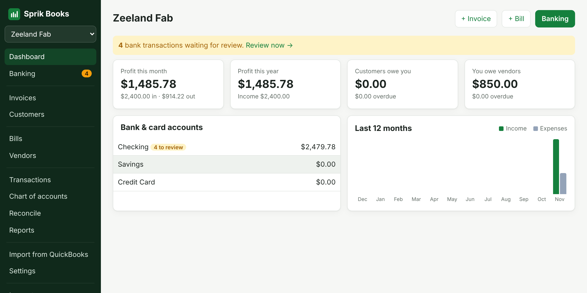

# Sprik Books

Our own bookkeeping app, built to replace QuickBooks. **Free forever, as many businesses as you want, and the data stays on your own computer.**

## What it does
- **Banking:** import your bank and credit card downloads (CSV, OFX, QFX, QBO). Duplicates are skipped. Each line gets a suggested category from your **rules** and from **what you picked before**. Accept them one at a time or all at once. You can also match a line to an invoice, bill or existing entry, split it, or exclude it.
- **✨ AI categorizing (optional):** Claude suggests categories for the lines the rules can't handle. This needs your own Anthropic API key, which usually costs pennies a month. Everything else works without it.
- **Invoices:** sales tax, automatic numbering, print or save as PDF, email, and receive full or partial payments.
- **Bills:** enter what you owe vendors, pay them, and see what's overdue.
- **Customers and vendors** with balances.
- **Reports:** Profit & Loss, Balance Sheet, A/R and A/P aging, Sales by customer, Expenses by vendor, Trial balance, and a register for every account. All of them export to CSV.
- **Reconcile** against your bank statements.
- **Import from QuickBooks:** chart of accounts, customers, vendors and your **full transaction history**. Any import can be undone.
- **Real double-entry accounting:** every invoice, bill, payment and bank line is a balanced journal entry, so the Balance Sheet always balances.
- **Closing date** to lock past years, a password login, and **automatic daily backups** (the last 30 are kept).
- **Works on your phone** over your home or shop Wi-Fi.

Payroll isn't included. Keep using a payroll service (Gusto, ADP, your bank) and record each payroll as an expense, or set a bank rule for it.

## Start it
1. Install **Node.js** (the LTS version) from https://nodejs.org. You only do this once.
2. Download this repo (green **Code** button → **Download ZIP**) and unzip it.
3. Open the `books` folder:
   - **Windows:** double-click `start.bat`
   - **Mac/Linux:** run `./start.sh` in a terminal
4. Your browser opens at http://localhost:8080. Choose a password and set up your business.

Keep the black window open while you use the app. The window also shows a `http://192.168…:8080` address. Open that on your phone (on the same Wi-Fi) and choose "Add to Home Screen".

> Put it on the computer that's on most of the time, like the office PC. The data lives in `books/data/books.db`, and daily backups go in `books/data/backups/`. Download a copy now and then from **Settings → Download backup**, and keep it on a USB stick or in a cloud folder.

## Moving off QuickBooks
In the app, go to **Import from QuickBooks** and follow the 4 steps:
1. **Chart of accounts:** QuickBooks Online: Settings → Chart of accounts → Run report → Export to Excel → Save As CSV.
2. **Customers and vendors:** Sales → Customers → Export, and Expenses → Vendors → Export. Save each as CSV.
3. **All transactions:** Reports → **Journal** → Report period **All Dates** → Export to Excel → Save As CSV.
4. **Check it:** compare the Balance Sheet and Profit & Loss with QuickBooks for the same dates. Then set a **closing date** in Settings.

Once the numbers match, connect your bank downloads, cancel QuickBooks, and keep your last QuickBooks export somewhere safe.

QuickBooks Desktop also works. Use Reports → Accountant & Taxes → Journal / Account Listing → Excel → CSV.

## For tinkerers
- Plain Node.js (22.13 or newer) with the built-in SQLite. The only dependency is the optional `@anthropic-ai/sdk`, used for AI categorizing. There's no build step.
- `npm test` runs the accounting tests.
- Settings: `PORT` (default 8080), `HOST` (default `0.0.0.0`), and `BOOKS_DATA` (the data folder).
- The app is meant for your own network. Don't expose it to the open internet without HTTPS in front of it, for example a Cloudflare Tunnel.
